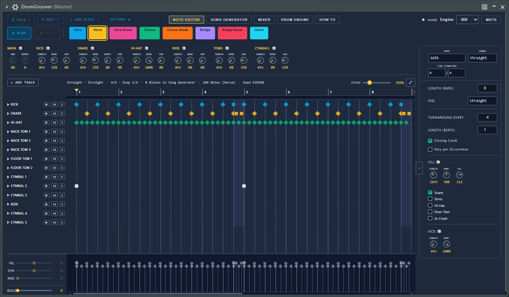
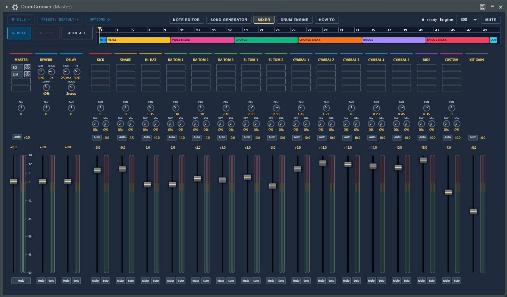

# DrumGroover

A drum groove generator and drum synthesizer as a VST3 instrument plugin. It writes drum patterns for you (kick, snare, hi-hat, ride, toms, cymbals and custom percussion), arranges them into a song, plays them with a synthesized TR-808 sound, and exports them as MIDI, or drags them straight into your DAW.

**Version 0.8 (first public release).** Tested on Windows 11 with VST3 hosts. The macOS code paths exist but have never been built or run; see [Status](#status).


Framework iplug2

## 📸 Preview

| Note Editor | Song Generator |
| :---: | :---: |
|  |  |

| Mixer | Drum Engine |
| :---: | :---: |
|  |  |

## What it does

- **Groove generator.** Generates patterns per instrument group from density, variation, subdivision, feel and phrase length. Every instrument has its own phrase length; generated groups can be edited by hand in the note editor.
- **Blocks and timeline.** Patterns live in blocks (main, break, fill). The timeline arranges blocks into a song, with a note preview in every clip. Playback follows the host transport, or runs on its own with the plugin's Play button.
- **Two sound engines.**
  - *808*: the drum voices are models of the Roland TR-808 circuits, calibrated against recordings of a hardware reproduction. Kick, snare, rim shot, claves, hand clap, maracas, toms and congas, cowbell, PC-2 percussion, hi-hat, ride and cymbals.
  - *Lo-Fi*: a simpler synthesis engine.
- **Mixer.** One channel per instrument with fader, pan, mute/solo, EQ and limiter slots, sends to reverb and delay buses, a master chain with a look-ahead limiter, and mixer presets.
- **MIDI export.** Export the song or single blocks as `.mid` files, or drag clips from the timeline directly into the DAW's playlist.
- **Project state.** All patterns, song, engine settings and the mixer are saved inside the host project.

## Requirements

- Windows 64 bit (tested on Windows 11) and a VST3 host.
- The Microsoft Edge WebView2 Runtime (already present on current Windows 11). The user interface is a web page shown in a WebView2 control; it is compiled into the plugin DLL, so no files besides the `.vst3` are needed.
- A CPU with AVX2 is not required. A build with `-DDGG_AVX2=ON` is faster at baking.

## First start

Hi-hat, ride and cymbal sounds are rendered once and cached in `%APPDATA%\DrumGroover\Cache`. The first start shows a short "Preparing the sound cache" dialog. On a recent desktop CPU this takes a few seconds. The cache size limit is set in the Drum Engine tab (Cache panel).

## Building from source

DrumGroover is built with [iPlug2](https://github.com/iPlug2/iPlug2), which CMake downloads on the first configure (unmodified, pinned to the revision DrumGroover is built against, kept out of this repository). Everything that differs from stock iPlug2 lives in this repository (`source/platform/DggWebView_win.cpp`, replacing iPlug2's Windows WebView backend via `CMakeLists.txt`).

```bash
git clone <this repository>
cd drum_groover
```

git must be installed; the first `cmake` run needs a network connection to fetch iPlug2 into `iPlug2/`.

Get the VST3 SDK for iPlug2 as described in iPlug2's documentation (`iPlug2/Dependencies/IPlug/download-iplug-sdks.sh`, or place the SDK in `iPlug2/Dependencies/IPlug/VST3_SDK`). Then, with Visual Studio 2022 and CMake 3.16 or newer:

```bash
mkdir build
cd build
cmake -G "Visual Studio 17 2022" -A x64 ..
cmake --build . --config Release
```

The first configure downloads the WebView2 SDK and WIL (header only), so it needs internet access.

The web view's developer tools (right-click, Inspect) are off by default; switch them on with Options > Developer tools.

During development you can point the plugin to the web files on disk instead of the embedded copy: set the environment variable `DGG_WEB_ROOT` to the `resources/web` folder, then JavaScript, CSS and HTML changes take effect without a rebuild.

## Repository layout

| Path | Content |
| --- | --- |
| `source/` | Plugin class (`DrumGroover.cpp/.h`), schedulers, groove generator, MIDI export |
| `source/dsp/` | Drum voices, mixer and the sound cache |
| `source/platform/` | Windows WebView2 backend, macOS file dialogs |
| `resources/web/` | The user interface (HTML, CSS, JavaScript) |
| `cmake/` | Build helper that embeds the web files into the DLL |
| `iPlug2/` | iPlug2 framework (fetched by CMake, not part of the repository) |

## Status

- Windows VST3: built and used.
- Not tested: macOS (the file dialogs and the WKWebView loading path are written but never built), other plugin formats, hosts other than the one the author uses, machines without the WebView2 Runtime.
- Bug reports and test results from other systems are welcome.

## Credits and licenses

- [iPlug2](https://github.com/iPlug2/iPlug2) (WDL license / MIT, see the framework's own license files)
- Microsoft Edge WebView2 SDK and WIL
- [nlohmann/json](https://github.com/nlohmann/json) (MIT)
- Steinberg VST3 SDK

DrumGroover itself is released under the [MIT License](LICENSE). The third-party components above keep their own licenses; the VST3 SDK in particular is subject to Steinberg's terms.
