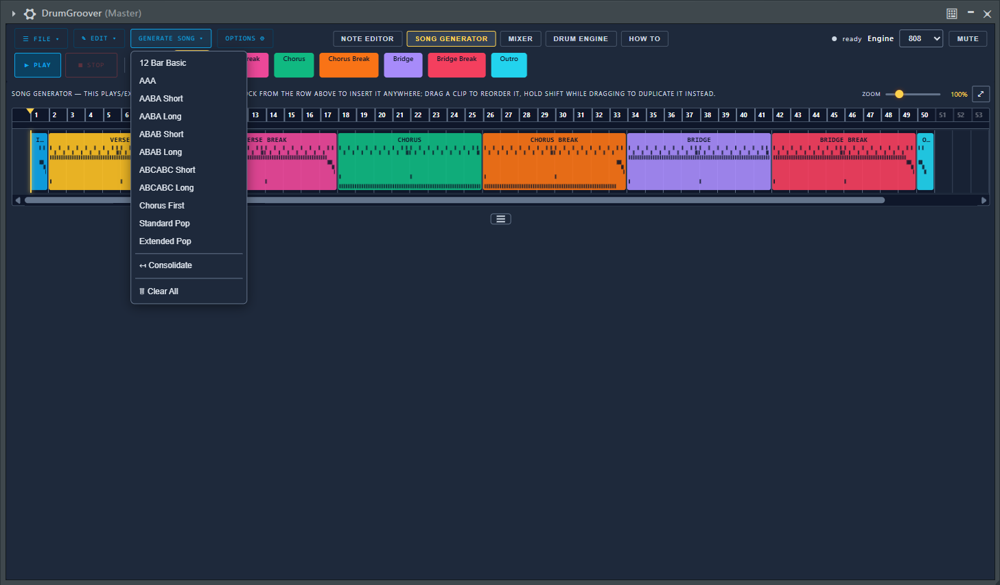
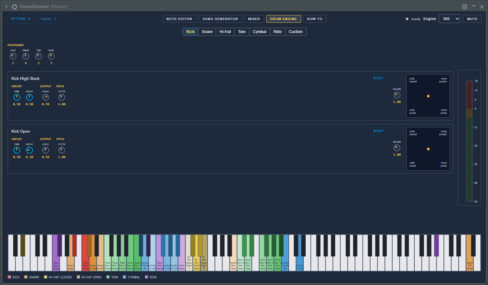

<div align="center">

# 🥁 DrumGroover

**A drum groove generator and TR-808 style drum synth, as a VST3 plugin.**

It writes drum patterns for you, arranges them into a song, plays them with a synthesized 808 kit, and exports them as MIDI or drags them straight into your DAW.


Built with [iPlug2](https://github.com/iPlug2/iPlug2)

</div>

> ⚠️ **Alpha (first public release).** It works and I use it, but expect rough edges. Windows 11, 64 bit, VST3 only for now. The macOS code paths exist but have never been built or run; see [Status](#-status).

## 📸 Preview

| Note Editor | Song Generator |
| :---: | :---: |
|  |  |

| Mixer | Drum Engine |
| :---: | :---: |
|  |  |

## 🎛️ What it does

- **Groove generator.** Generates patterns per instrument group from density, variation, subdivision, feel and phrase length. Every instrument has its own phrase length; generated groups can be edited by hand in the note editor.
- **Blocks and timeline.** Patterns live in blocks (main, break, fill). The timeline arranges blocks into a song, with a note preview in every clip. Playback follows the host transport, or runs on its own with the plugin's Play button.
- **Two sound engines.**
  - *808*: the drum voices are models of the TR-808 circuits, based on the [Yocto V2.0](https://github.com/e-licktronic/Yocto-V2.0), simulated in NGSpice and calibrated against recordings of the Yocto 2. Kick, snare, rim shot, claves, hand clap, maracas, toms and congas, cowbell, PC-2 percussion, hi-hat, ride and cymbals.
  - *Lo-Fi*: a simpler synthesis engine.
- **Mixer.** One channel per instrument with fader, pan, mute/solo, EQ and limiter slots, sends to reverb and delay buses, a master chain with a look-ahead limiter, and mixer presets.
- **MIDI export.** Export the song or single blocks as `.mid` files, or drag clips from the timeline directly into the DAW's playlist.
- **Project state.** All patterns, song, engine settings and the mixer are saved inside the host project.

## 💡 How it came about

It started as a small HTML tool that randomized drum patterns for Superior Drummer. Then it became a VST plugin. Since there was a plugin anyway, I put a drum kit on top of it: a TR-808 clone based on the circuit of the Yocto V2.0. I simulated the circuit in NGSpice, tuned it against recordings of the Yocto 2, and rebuilt it in C++. Everything runs in real time except the hi-hat, ride and cymbals, which were too slow; they are rendered ahead of time and played from a cache.

## 📋 Requirements

- Windows 11, 64 bit, and a VST3 host. Windows 10 is not supported.
- The Microsoft Edge WebView2 Runtime (included with Windows 11; if it is missing, the plugin says so and offers the download page). The user interface is a web page shown in a WebView2 control; it is compiled into the plugin DLL, so no files besides the `.vst3` are needed.
- A CPU with AVX2 is not required. A build with `-DDGG_AVX2=ON` is faster at baking.

## 🚀 First start

Hi-hat, ride and cymbal sounds are rendered once and cached in `%APPDATA%\DrumGroover\Cache`. The first start shows a short "Preparing the sound cache" dialog. On a recent desktop CPU this takes a few seconds. The cache size limit is set in the Drum Engine tab (Cache panel).

## 🔨 Building from source

DrumGroover is built with [iPlug2](https://github.com/iPlug2/iPlug2), which CMake downloads on the first configure (unmodified, pinned to the revision DrumGroover is built against, kept out of this repository). Everything that differs from stock iPlug2 lives in this repository (`source/platform/DggWebView_win.cpp`, replacing iPlug2's Windows WebView backend via `CMakeLists.txt`).

```bash
git clone https://github.com/ReinerBforartists/Drumgroover
cd Drumgroover
```

git must be installed; the first `cmake` run needs a network connection to fetch iPlug2 into `iPlug2/`.

Get the VST3 SDK for iPlug2 as described in iPlug2's documentation (`iPlug2/Dependencies/IPlug/download-iplug-sdks.sh`, or place the SDK in `iPlug2/Dependencies/IPlug/VST3_SDK`). Then, with Visual Studio 2022 and CMake 3.16 or newer:

```bash
mkdir build
cd build
cmake -G "Visual Studio 17 2022" -A x64 ..
cmake --build . --config Release
```

The first configure downloads the WebView2 SDK and WIL (header only), so it needs internet access.

The web view's developer tools (right-click, Inspect) are off by default; switch them on with Options > Developer tools.

During development you can point the plugin to the web files on disk instead of the embedded copy: set the environment variable `DGG_WEB_ROOT` to the `resources/web` folder, then JavaScript, CSS and HTML changes take effect without a rebuild.

## 📁 Repository layout

| Path | Content |
| --- | --- |
| `source/` | Plugin class (`DrumGroover.cpp/.h`), schedulers, groove generator, MIDI export |
| `source/dsp/` | Drum voices, mixer and the sound cache |
| `source/platform/` | Windows WebView2 backend, macOS file dialogs |
| `resources/web/` | The user interface (HTML, CSS, JavaScript) |
| `cmake/` | Build helper that embeds the web files into the DLL |
| `iPlug2/` | iPlug2 framework (fetched by CMake, not part of the repository) |

## 🧪 Status

- Windows 11 VST3: built and used. Alpha, expect rough edges.
- Windows only for now. macOS: the file dialogs and the WKWebView loading path are written but never built. No other plugin formats. Tested with the DAW the author uses; other DAWs should work but haven't been tried.
- Bug reports and test results from other DAWs are welcome.

## 🙏 Credits

- [Yocto V2.0](https://github.com/e-licktronic/Yocto-V2.0) by e-licktronic: the 808 engine is based on its circuit and tuned against recordings of the Yocto 2. No Yocto files are part of this repository.
- [iPlug2](https://github.com/iPlug2/iPlug2) by Oliver Larkin and contributors: the plugin framework (WDL license / MIT, see the framework's own license files).
- [nlohmann/json](https://github.com/nlohmann/json): JSON parsing (MIT, comes with iPlug2).
- Microsoft Edge WebView2 SDK and WIL: the web view the user interface runs in.
- Steinberg VST3 SDK (MIT).

All third-party components keep their own licenses.

## 📜 License

DrumGroover is released under the [MIT License](LICENSE).
